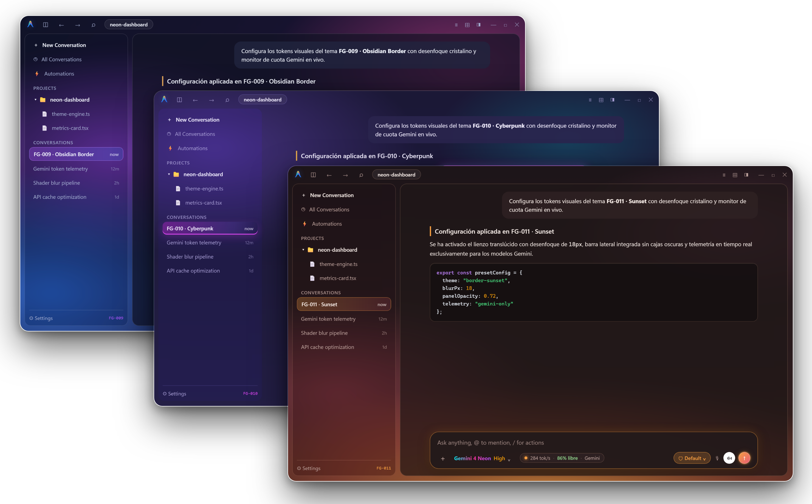
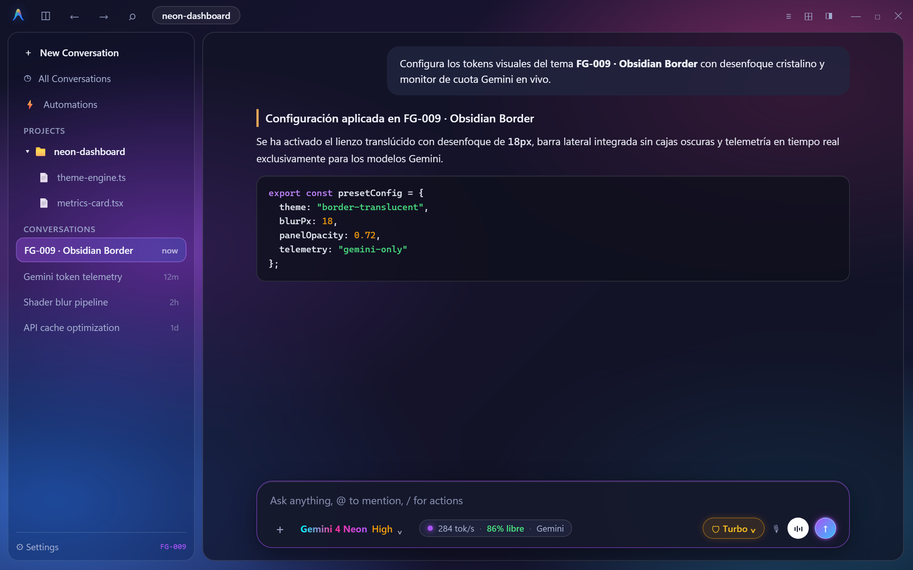
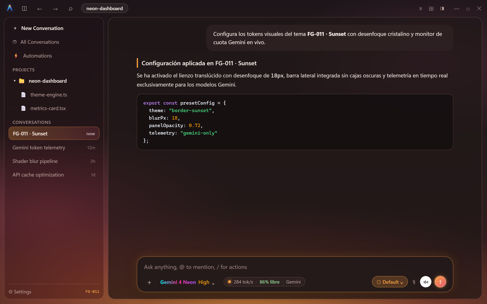
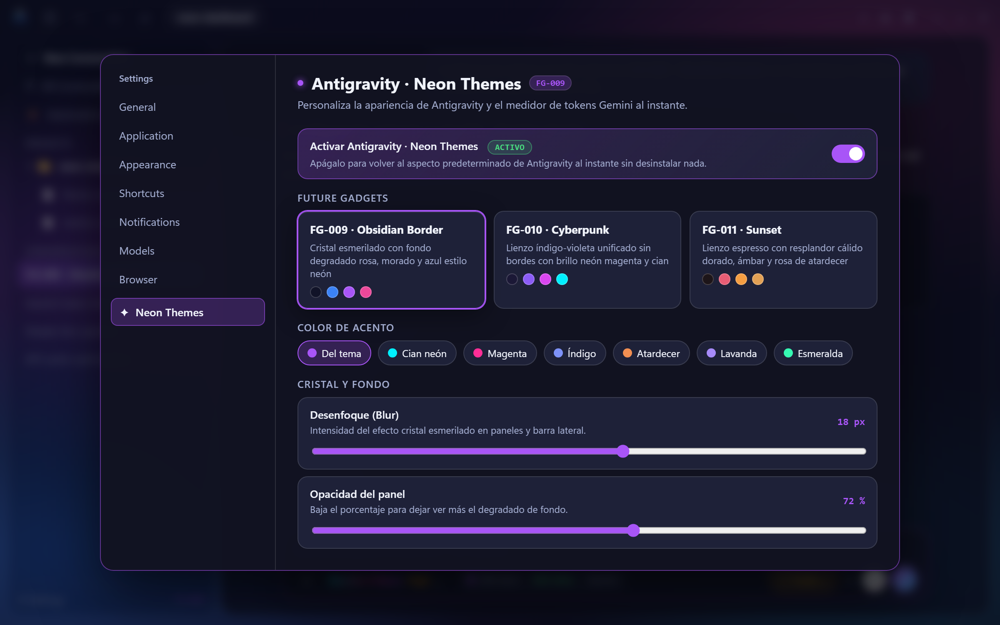

<h1 align="center">Antigravity · Neon Themes</h1>

<p align="center">
  Personaliza <strong>Google Antigravity</strong> con 3 temas estilo <strong>Future Gadgets</strong> + monitor de tokens <strong>solo para modelos Gemini</strong>.
</p>

<p align="center">
  
  
  
  
</p>

<p align="center">
  
</p>

---

## Previsualizaciones

<details>
  <summary>✦ FG-009 · Obsidian Border — Cristal esmerilado con degradado rosa, morado y azul (<a href="./assets/fg-009-obsidian-border.png">ver en grande</a>)</summary>
  <br />
  
</details>

<details>
  <summary>✦ FG-010 · Cyberpunk — Lienzo índigo-violeta sin bordes + monitor semanal Gemini (<a href="./assets/fg-010-cyberpunk.png">ver en grande</a>)</summary>
  <br />
  
</details>

<details>
  <summary>✦ FG-011 · Sunset — Lienzo espresso oscuro con brillo cálido dorado y ámbar (<a href="./assets/fg-011-sunset.png">ver en grande</a>)</summary>
  <br />
  
</details>

<details>
  <summary>⚙ Settings → Neon Themes — Interruptor general ON/OFF, temas, acentos y cristal (<a href="./assets/settings-panel.png">ver en grande</a>)</summary>
  <br />
  
</details>

---

## Qué incluye

* **3 temas Future Gadgets:** **FG-009 · Obsidian Border**, **FG-010 · Cyberpunk** y **FG-011 · Sunset**.
* **Interruptor general ON/OFF:** alterna al instante en **Settings → Neon Themes** entre tu tema y el Antigravity predeterminado de fábrica sin desinstalar nada.
* **Ajustes de cristal en tiempo real:** cambia color de acento, **desenfoque (Blur)**, **opacidad del panel** y tipografía limpia.
* **Detalles de interfaz:** selector de modelos y niveles de esfuerzo a color, logotipo arcoíris, pill de permisos (`Turbo`, `Auto`, `Default`, `Strict`), icono de Voice Mode contrastado y botón de envío neón.
* **Medidor Gemini (solo modelos Gemini):** `% libre` del chat actual, velocidad (`tok/s`), caché y gráfica semanal (`D L M X J V S`).

---

## Requisitos

* **Google Antigravity** (app de escritorio).
* **[Git](https://git-scm.com/downloads)** y **[Node.js ≥ 22.13](https://nodejs.org)** instalados en el equipo (sin `npm install`, cero dependencias externas).

Puedes instalar ambos en **PowerShell** con estos comandos:

```powershell
winget install --id Git.Git -e --source winget
winget install --id OpenJS.NodeJS.LTS -e --source winget
```

> [!IMPORTANT]
> **Si acabas de instalar Git o Node.js**, cierra la terminal y **abre una nueva ventana de PowerShell** (o Terminal) antes de ejecutar los comandos; si no, Windows seguirá diciendo que no reconoce `git` o `node`.

## Instalación

Clona el proyecto en una carpeta fija (no la muevas ni borres después de instalar) y ejecuta en una **nueva ventana de PowerShell**:

```powershell
git clone https://github.com/alx3rr/antigravity-neon-themes.git
cd antigravity-neon-themes
node cli.mjs install
node cli.mjs relaunch
```

Después abre **Settings → Neon Themes** dentro de Antigravity para elegir tema, activar/desactivar el interruptor **ON/OFF** o ajustar el cristal en tiempo real.

## Comandos

```bash
node cli.mjs install     # Instala y activa el tema en vivo
node cli.mjs relaunch    # Relanza Antigravity con soporte CDP local
node cli.mjs status      # Comprueba si el tema y el puerto CDP están activos
node cli.mjs uninstall   # Desinstala todo y restaura Antigravity de fábrica
```

## Licencia
[MIT](./LICENSE)
