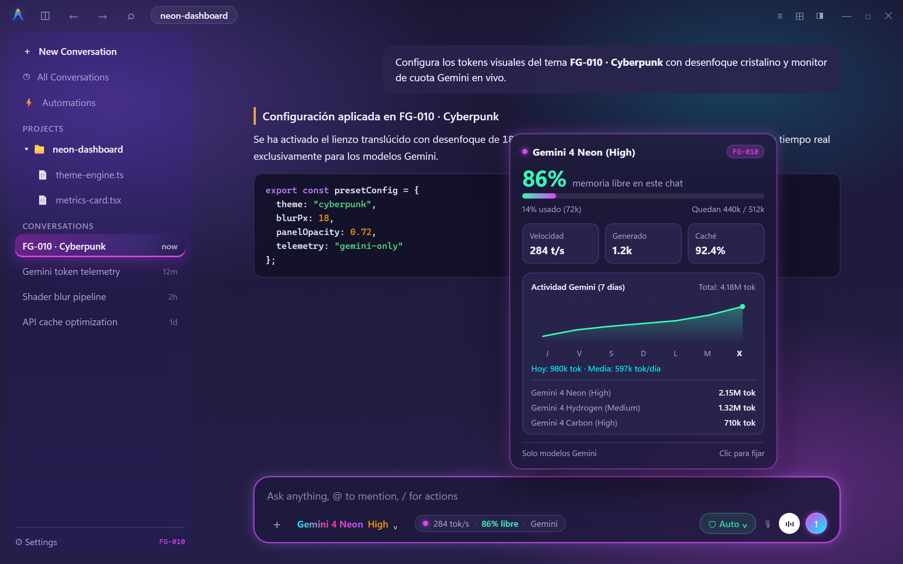

<h1 align="center">Antigravity · Neon Themes</h1>

<p align="center">
  Personaliza <strong>Google Antigravity</strong> con 3 temas estilo <strong>Future Gadgets</strong> (<strong>FG-009 · Obsidian Border</strong>, <strong>FG-010 · Cyberpunk</strong> y <strong>FG-011 · Sunset</strong>) + monitor de tokens y actividad semanal <strong>solo para modelos Gemini</strong>.
</p>

<p align="center">
  
  = 22.13" src="https://img.shields.io/badge/Node.js-%E2%89%A5%2022.13-38bdf8?style=for-the-badge" />
  
  
</p>

<p align="center">
  
</p>

Sin dependencias externas (`npm install` no es necesario), 100 % en español, ligero y sin modificar los binarios de Antigravity.

---

## Previsualizaciones

Haz clic en cada tema para ver la captura completa o ábrela directamente en grande:

<details>
  <summary>✦ FG-009 · Obsidian Border — Cristal esmerilado con degradado rosa, morado y azul (<a href="./assets/fg-009-obsidian-border.png">ver a tamaño completo</a>)</summary>
  <br />
  
</details>

<details>
  <summary>✦ FG-010 · Cyberpunk — Lienzo índigo-violeta sin bordes + monitor semanal Gemini (<a href="./assets/fg-010-cyberpunk.png">ver a tamaño completo</a>)</summary>
  <br />
  
</details>

<details>
  <summary>✦ FG-011 · Sunset — Lienzo espresso oscuro con brillo cálido dorado y ámbar (<a href="./assets/fg-011-sunset.png">ver a tamaño completo</a>)</summary>
  <br />
  
</details>

<details>
  <summary>⚙ Settings → Neon Themes — Interruptor general ON/OFF, temas, acentos y cristal (<a href="./assets/settings-panel.png">ver a tamaño completo</a>)</summary>
  <br />
  
</details>

---

## Qué incluye

### Future Gadgets (Temas)
| Tema | Inspiración | Estética |
| :--- | :--- | :--- |
| [**FG-009 · Obsidian Border**](./assets/fg-009-obsidian-border.png) | Obsidian Border (*Translucent*) | Cristal esmerilado con fondo degradado rosa, morado y azul estilo neón. |
| [**FG-010 · Cyberpunk**](./assets/fg-010-cyberpunk.png) | SynthWave '84 | Lienzo índigo-violeta unificado sin bordes con acento neón magenta y cian. |
| [**FG-011 · Sunset**](./assets/fg-011-sunset.png) | Obsidian Border (*Sunset*) | Lienzo espresso oscuro con brillo cálido dorado, ámbar y rosa desde la parte inferior. |

### Medidor Gemini (solo modelos Gemini)
Pasa el ratón (o haz clic para fijarlo) sobre la barra inferior del chat para ver:
* **Memoria restante del chat actual** (`% libre` + barra verde → amarilla → roja).
* **Resumen humano del último turno:** velocidad (`tok/s`), tokens generados y `%` de caché reutilizada.
* **Gráfica semanal Gemini (`D L M X J V S`):** consumo diario de los últimos 7 días con línea de ritmo proyectado y desglose por modelo Gemini.

### Ajustes simples en `Settings → Neon Themes`
* **Interruptor general ON/OFF:** activa o desactiva todo el tema al instante para volver al **Antigravity predeterminado de fábrica** sin desinstalar nada.
* Selector rápido de **Future Gadgets** con 1 clic.
* Selector de **color de acento** (o automático del tema).
* Controles de **desenfoque (Blur)** y **opacidad del panel** en tiempo real.
* Colores diferenciados en el selector de modelos y niveles de esfuerzo (con efecto neón animado en **Gemini 4 Neon** y botón **View Usage** destacado).
* Logotipo vectorial arcoíris de Antigravity, pill de permisos por color (`Turbo`, `Auto`, `Default`, `Strict`), icono de Voice Mode contrastado y botones neón de envío/parada.
* **Tipografía limpia** (estilo Inter + JetBrains Mono).
* Activar/desactivar la barra de tokens Gemini (conservando la pestaña activa al cambiar opciones).

---

## Requisitos
* **Google Antigravity** (app de escritorio).
* **Node.js ≥ 22.13.0** — compruébalo con `node -v` (usa `node:sqlite` y `WebSocket` nativos; **no hace falta `npm install`**).
* **Git** (o descargar el repositorio como ZIP desde GitHub).

## Instalación paso a paso

> [!NOTE]
> Clona el repositorio en una carpeta fija que no vayas a mover ni borrar (el demonio en segundo plano se ejecuta desde esa ruta al iniciar sesión). Si algún día cambias la carpeta de sitio, vuelve a ejecutar `node cli.mjs install` desde la nueva ubicación.

### 1. Descarga el proyecto
Abre una terminal (**PowerShell** en Windows o Terminal en macOS/Linux) y ejecuta:

```bash
git clone https://github.com/alx3rr/antigravity-neon-themes.git
cd antigravity-neon-themes
```

### 2. Instala y activa el tema
```bash
node cli.mjs install
```

*(Opcional)* Si quieres empezar directamente con un tema concreto, pasa `--preset`:

```bash
node cli.mjs install --preset border-translucent   # FG-009 · Obsidian Border
node cli.mjs install --preset cyberpunk            # FG-010 · Cyberpunk (por defecto)
node cli.mjs install --preset border-sunset        # FG-011 · Sunset
```

Qué hace `install` automáticamente:
* Guarda tus preferencias en `~/.antigravity-neon-themes/config.json` (si vienes de una versión anterior con `.antigravity-worldline`, la migra y limpia automáticamente).
* Arranca el demonio ligero en segundo plano.
* En **Windows**, añade `--remote-debugging-port=0` a los accesos directos de Antigravity y configura el inicio automático para que el tema se cargue siempre al abrir la app.

### Qué carpetas verás en tu equipo
* **`antigravity-neon-themes/`** (donde hiciste `git clone`): contiene el código del proyecto y `cli.mjs`.
* **`~/.antigravity-neon-themes/`** (en tu carpeta de usuario, ej. `C:\Users\TuUsuario\.antigravity-neon-themes`): carpeta oculta que guarda `config.json`, `daemon.pid` y el script de arranque. **Solo existe esa carpeta de datos**.

### 3. Relanza Antigravity (solo la primera vez)
Si la consola indica que Antigravity aún no expone el puerto CDP, ejecuta:

```bash
node cli.mjs relaunch
```

Esto cerrará y volverá a abrir Antigravity con soporte CDP local (`--remote-debugging-port=0`) y aplicará el tema al instante. En Windows, a partir de aquí ya podrás abrir Antigravity normalmente desde su acceso directo.

### 4. Verifica y personaliza
Comprueba que el demonio y la ventana están conectados:

```bash
node cli.mjs status
```

Después abre **Settings → Neon Themes** dentro de Antigravity para cambiar entre los 3 **Future Gadgets**, elegir el **color de acento**, ajustar el **desenfoque (Blur)** y la **opacidad del panel** en tiempo real.

## Comandos

```bash
node cli.mjs install [--preset border-translucent|cyberpunk|border-sunset]  # Instala y activa el tema en vivo
node cli.mjs relaunch    # Relanza Antigravity con soporte CDP local
node cli.mjs status      # Comprueba el estado del demonio, tema activo y ventana CDP
node cli.mjs uninstall   # Desinstala todo, limpia el inicio automático y restaura Antigravity original
```

## Solución de problemas rápida
* **Al reiniciar Antigravity no sale el tema:** ejecuta `node cli.mjs status`. Si aparece `Puerto CDP: No detectado`, abre Antigravity desde su acceso directo actualizado (Escritorio / Menú Inicio) o ejecuta `node cli.mjs relaunch`.
* **En Linux:** lanza Antigravity con `antigravity --remote-debugging-port=0` después de ejecutar `node cli.mjs install`.
* **Desinstalación limpia:** ejecuta `node cli.mjs uninstall` antes de borrar la carpeta del proyecto para detener el demonio y restaurar los accesos directos originales.

---

## Licencia
[MIT](./LICENSE)
